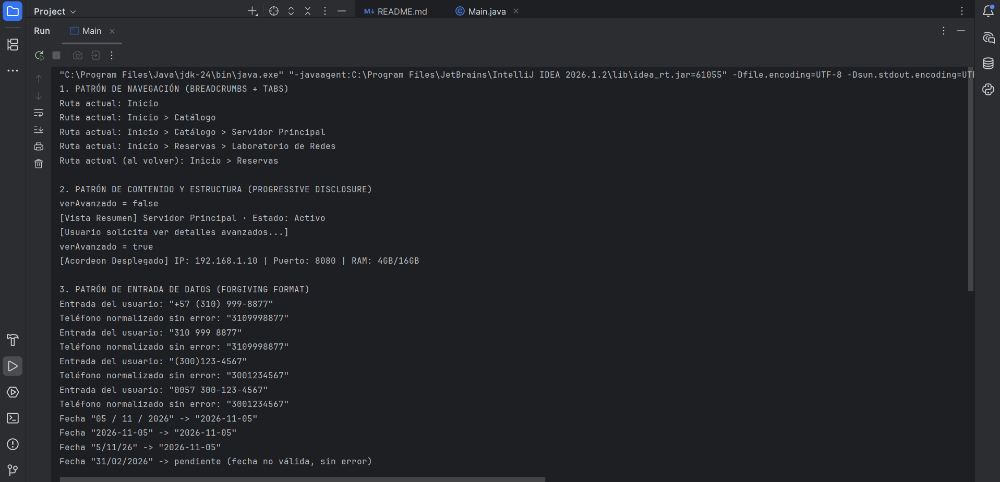

# Taller User Interface Patterns 

Sistema de Configuración y Reservas Universitarias.

## Estructura
```
src/
├── navigation/BreadcrumbNavigator.java   # Breadcrumbs + Tabs
├── content/TarjetaElemento.java          # Progressive Disclosure
├── input/ValidadorForgiving.java         # Forgiving Format
├── state/GestorSesionUI.java             # Lazy Registration + Completeness Meter + Toast
└── main/Main.java                        # 5 casos de prueba
```

## Compilar y ejecutar
```bash
mkdir out
javac -encoding UTF-8 -d out $(find src -name "*.java")
java -Dfile.encoding=UTF-8 -cp out main.Main
```
La salida de referencia esta en `salida_consola.txt`.


## Como se evitan los Dark Patterns
Para que la interfaz no engañe ni presione al usuario, cada clase esta pensada desde lo que el estudiante necesita y no desde lo que le conviene al sistema. Con el Lazy Registration, cualquiera puede armar su reserva sin crear cuenta; solo se le pide registrarse al guardar, y mientras tanto su avance queda en un borrador para que no pierda nada. Cancelar la reserva o cerrar sesión se hace en un solo paso, sin pantallas extra ni preguntas para retenerlo asi evitamos el Roach Motel, y los mensajes son simples, tipo "Reserva cancelada" o "Sesión cerrada", sin frases que lo hagan sentir mal por irse nada de Confirmshaming. Tampoco se esconde nada el medidor de progreso siempre dice cuanto y que campo falta, y las migas de pan muestran en que parte del sitio esta, asi que no hay costos ni pasos sorpresa (Drip Pricing) ni botones que lo lleven a donde no quiere (Misdirection). Lo unico que se oculta son los detalles tecnicos, y se abren con un clic cuando el usuario los pide. Por ultimo, el validador acepta el telefono como lo escriba la persona, con espacios, guiones o +57, y lo arregla por dentro; si no entiende un dato, no le tira un error, solo lo deja pendiente.
